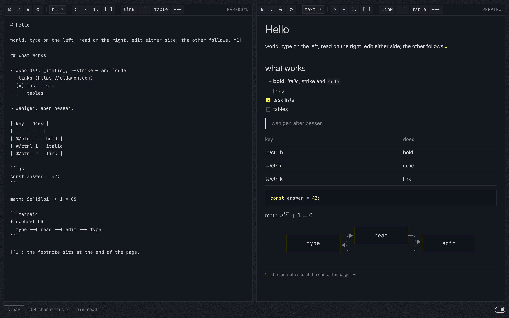

# Markdown.

A two-pane markdown preview. Source left, preview right; edit either side. Drop a .md file on a card to open it.

<picture>
  <source media="(prefers-color-scheme: light)" srcset="docs/screenshot-light.png">
  
</picture>

The footer has `clear` on the left and the theme switch on the right.

```sh
npm install
npm run dev     # http://localhost:4410
npm test        # unit tests
npm run e2e     # end-to-end tests in Chromium
```

`npm run e2e` runs Playwright against http://localhost:4410. It uses a dev server that already runs there, or starts `npm run dev`. The tests import `test`, `expect` and the helpers from `e2e/helpers.ts`: a test fails on any console error or page error. A failed run writes its details to `test-results/`.

Next.js (App Router), React and TypeScript. The tokens in `src/styles/uldagon.css` come from the ULDAGON design system.

The code is under the MIT license (`LICENSE`). The JetBrains Mono fonts in `src/fonts/` are under the SIL Open Font License 1.1 (`src/fonts/OFL.txt`).

| file | what |
|---|---|
| `src/app/` | layout (fonts, theme script), page, global styles |
| `src/components/Editor.tsx` | state, file drop, clear, keys, scroll sync between the two cards |
| `src/components/Footer.tsx` | clear, the status line, a note, the theme switch |
| `src/components/Select.tsx` | the themed dropdown of the heading picker |
| `src/components/Toolbar.tsx` | the one tool list both cards share, and the inline field for a URL or TeX |
| `src/components/Preview.tsx` | the rendered card; its tools make the source edits of the markdown card |
| `src/components/preview-selection.ts` | a selection in the preview as a selection of the source, and back |
| `src/components/preview-commands.ts` | the link tool, Enter in lists and quotes, and the toolbar state of the preview |
| `src/lib/source-edits.ts` | markdown edits on the source as pure functions |
| `src/lib/store.ts` | localStorage that never throws; `set` says whether the value was kept |
| `src/lib/stats.ts` | the status line: characters, size, reading time |
| `src/lib/markdown/` | markdown to HTML and back |
| `tests/` | `npm test` |
| `e2e/` | `npm run e2e`; `helpers.ts` opens the app with a text, selects text in either card, and clicks tools |
